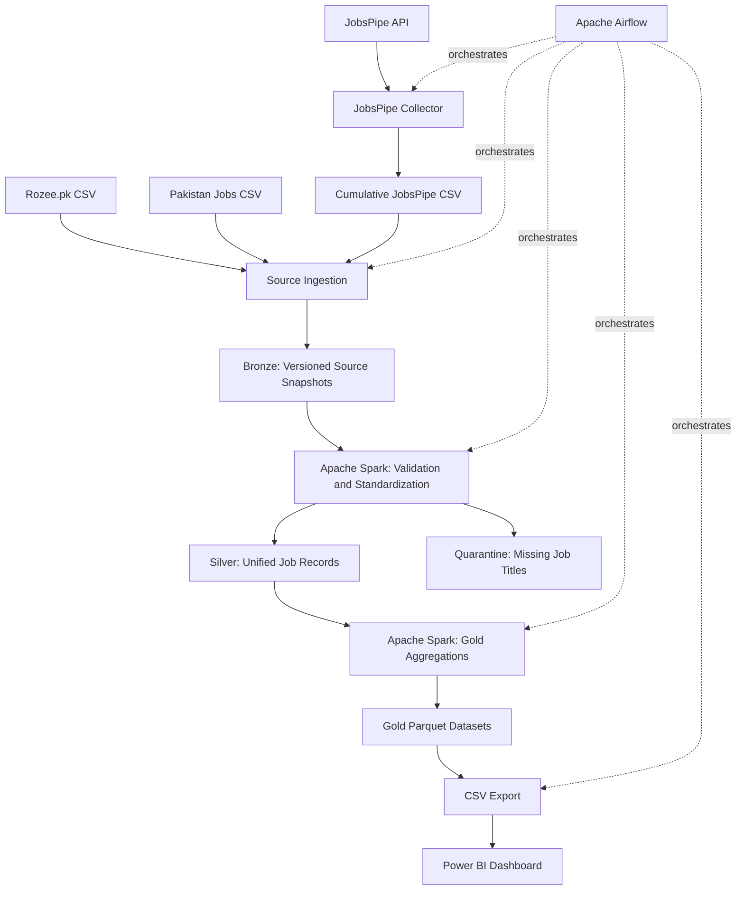

# Pakistan Job Market Data Engineering Platform

An end-to-end data engineering portfolio project that collects Pakistan job listings from multiple sources, preserves source snapshots, standardizes records with Apache Spark, builds analytical datasets, and exports CSVs for Power BI reporting.

> **Portfolio note:** This is a learning and portfolio pipeline. JobsPipe collection currently requests one page of up to 25 records per run; it does not crawl every available API page. The Power BI export creates updated CSVs, but the Power BI report itself must be refreshed separately.

## Project Goals

- Ingest data from multiple job listing sources into a consistent pipeline.
- Preserve source snapshots and ingestion metadata in a Bronze layer.
- Clean, standardize, validate, and deduplicate jobs in a Silver layer.
- Quarantine records that do not meet the required job title quality rule.
- Build Gold datasets for market overview, sources, job types, functional areas, skills, locations, salaries, and posting trends.
- Orchestrate the collection and processing stages with Apache Airflow.
- Export Gold datasets to CSV for Power BI dashboards.

## Architecture



## Pipeline Workflow

The production DAG is `pakistan_job_market_data_pipeline`. Its current task order is:

1. **Validate project inputs**: check required source files and pipeline scripts, and confirm the JobsPipe API key is configured.
2. **Collect JobsPipe listings**: make one API request for up to 25 listings and update the cumulative JobsPipe CSV using job IDs to avoid adding duplicate IDs.
3. **Ingest sources**: validate source headers, checksum source files, and create Bronze snapshots with ingestion metadata. Unchanged inputs can be skipped.
4. **Build Silver**: select the latest successful Bronze snapshot per source, normalize common fields, combine source records, quarantine records with missing job titles, and remove exact duplicates.
5. **Build Gold**: create analytical Parquet datasets.
6. **Export Power BI data**: export each Gold dataset to a CSV and read the exports back to verify row counts.

The Airflow DAG uses `schedule=None`, so it is triggered manually in the Airflow UI unless a schedule is configured later. A successful CSV export does not automatically refresh an open Power BI report; refresh the report in Power BI after the export finishes.

## Data Sources

| Source | Input | Notes |
|---|---|---|
| Rozee.pk | `data/source/rozee/RozeePK_Jobs.csv` | User-provided CSV source. |
| Pakistan Jobs | `data/source/pakistan_jobs/pakistan_jobs.csv` | User-provided CSV source. May contain recruiter contact details and must remain private. |
| JobsPipe | `data/source/jobspipe/jobspipe_jobs.csv` | Cumulative file produced by the JobsPipe API collector. Salary fields may be missing in source results. |

The project preserves each source's context where useful, including source name, source job ID, source URL, and selected JobsPipe metadata. A common Silver schema supports combined analysis even when fields are unavailable in some sources.

## Medallion Data Layout

```text
data/
├── source/                 # Private source files; do not commit
├── bronze/                 # Versioned snapshots and ingestion metadata
├── silver/jobs/            # Standardized unified job records
├── quarantine/             # Records that fail required quality rules
├── gold/                   # Analytical Parquet datasets
└── exports/power_bi/       # CSV exports consumed by Power BI
```

Generated and raw data directories are local pipeline assets and should remain excluded from source control. The ingestion metadata records information such as source file name, checksum, row count, and ingestion status.

## Gold Datasets

The Gold build creates these eight datasets:

| Dataset | Purpose |
|---|---|
| `job_market_overview` | Overall market summary and KPIs. |
| `jobs_by_source` | Compare record counts by source. |
| `jobs_by_job_type` | Summarize jobs by job type. |
| `jobs_by_functional_area` | Summarize demand by functional area. |
| `salary_by_functional_area` | Salary aggregations where usable salary data exists. Always account for salary currency and pay-period differences before comparing values. |
| `top_skills` | Count skills mentioned in job listings. |
| `jobs_by_location_value` | Summarize records by the source location string. Multi-city strings are not necessarily split into individual locations. |
| `jobs_posted_by_month` | Count records with valid posting timestamps by month. Records without valid posting timestamps are excluded. |

Gold data is written to `data/gold/` as Parquet. Power BI CSV exports are written to `data/exports/power_bi/`.

## Technology Stack

- **Python** for collection, ingestion utilities, and pipeline control.
- **Pandas** for source CSV validation and supporting data operations.
- **Apache Spark / PySpark** for Silver transformations and Gold analytics.
- **Apache Airflow 3** for workflow orchestration.
- **Docker Compose** for the Airflow runtime.
- **Java** as the Spark runtime dependency.
- **CSV and Parquet** for source exchange, snapshots, and analytical storage.
- **Power BI** for interactive reporting.
- **JobsPipe API** as an additional job listing source.
- **Git and GitHub** for version control of code and documentation.

## Prerequisites

- Git
- Python and `pip`, compatible with the versions declared in `requirements.txt`
- Java compatible with the installed PySpark version for local Spark execution
- Docker Desktop with the WSL 2 backend for the Airflow Docker setup
- Power BI Desktop to open and refresh the dashboard
- A JobsPipe API key for API collection

The project was developed on Windows with Git Bash and VS Code. The Airflow Docker image is built from `airflow/Dockerfile`; local Windows Spark execution may need a configured `HADOOP_HOME` and `winutils.exe`.

## Local Setup

Run commands from the repository root unless a command says otherwise.

### 1. Create and activate the Python environment

In Git Bash:

```bash
python -m venv .venv
source .venv/Scripts/activate
python -m pip install --upgrade pip
pip install -r requirements.txt
```

If `.venv` already exists, activate it rather than creating it again:

```bash
source .venv/Scripts/activate
```

### 2. Configure the JobsPipe API key for a local collector run

Provide the key through the `JOBSPIPE_API_KEY` environment variable. Do not hardcode it in a Python file or commit it to Git.

For an interactive, hidden prompt in Git Bash:

```bash
read -s -p "JobsPipe API key: " JOBSPIPE_API_KEY
echo
export JOBSPIPE_API_KEY
```

Run the collector with:

```bash
python collectors/collect_jobspipe.py
```

The collector requests one page of up to 25 records per run and updates `data/source/jobspipe/jobspipe_jobs.csv`. Check the JobsPipe API terms and credit limits before increasing collection volume.

### 3. Run ingestion and Spark transformations manually

Run from the repository root:

```bash
python -m ingestion.run_ingestion
python spark_jobs/build_silver.py
python spark_jobs/build_gold.py
python spark_jobs/export_gold_for_powerbi.py
```

On Windows, local Spark writes may require the Hadoop utility environment setup used during development. In Git Bash, for the current local installation:

```bash
export HADOOP_HOME="C:/hadoop/hadoop-3.5.0"
export PATH="/c/hadoop/hadoop-3.5.0/bin:$PATH"
```

Adjust those paths if Hadoop utilities are installed elsewhere on your machine. These commands set variables only for the current terminal session.

## Run Airflow with Docker Compose

The lightweight Airflow configuration is in `airflow/compose-lite.yaml`.

### 1. Configure Airflow environment variables

Create or edit `airflow/.env` locally. Keep the existing values for `AIRFLOW_UID`, `AIRFLOW_PROJ_DIR`, and `FERNET_KEY`. Add the JobsPipe key as a separate line:

```dotenv
AIRFLOW_UID=50000
AIRFLOW_PROJ_DIR=.
FERNET_KEY=your_existing_fernet_key
JOBSPIPE_API_KEY=your_jobs_pipe_api_key
```

These are illustrative values except for the variable names. Use your own generated secrets locally. Never commit `airflow/.env`, and never include the actual key in screenshots, logs, or documentation.

The Compose service must pass the key into the container through its `environment` section:

```yaml
JOBSPIPE_API_KEY: ${JOBSPIPE_API_KEY}
```

### 2. Start Airflow

From Git Bash:

```bash
cd "/e/Pakistan Job Market DE Platform/airflow"
docker compose -f compose-lite.yaml up -d
```

On first setup, build the image if necessary:

```bash
docker compose -f compose-lite.yaml up -d --build
```

Open `http://localhost:8080` and sign in with the locally generated Airflow credentials. Do not publish credentials or secret configuration files.

### 3. Verify the DAG and task list

```bash
docker compose -f compose-lite.yaml exec airflow airflow dags list-import-errors
docker compose -f compose-lite.yaml exec airflow airflow dags list
docker compose -f compose-lite.yaml exec airflow airflow tasks list pakistan_job_market_data_pipeline
```

In the Airflow UI, find `pakistan_job_market_data_pipeline` and trigger it manually. Review each task's status and logs. The collector should execute before ingestion, Silver, Gold, and Power BI export.

### 4. Stop or restart the service

To restart the service after editing configuration:

```bash
docker compose -f compose-lite.yaml up -d
```

To stop the containers:

```bash
docker compose -f compose-lite.yaml down
```

Before using `down` or rebuilding, make sure important Airflow metadata is persisted. The current lightweight setup should be reviewed for explicit metadata database persistence before relying on long-term run history.

## Power BI

1. Open the Power BI `.pbix` report.
2. Ensure the eight CSV data sources point to `data/exports/power_bi/` in this repository.
3. Trigger the pipeline and wait for `export_powerbi_data` to succeed.
4. Select **Home → Refresh** in Power BI.
5. Check the source comparison, job types, functional areas, skills, locations, posting trend, and salary visuals.

Do not interpret missing salary as zero. Salary comparisons should be restricted to comparable currencies and pay periods.

## Data Privacy and GitHub Security

Some source files may include recruiter phone numbers or email addresses. The following must remain local and excluded from GitHub:

- `airflow/.env` and any other `.env` files containing credentials
- `data/source/`, including original source CSVs and the cumulative JobsPipe file
- Generated Bronze, Silver, Gold, quarantine, and Power BI export data
- Logs, local metadata, `.venv/`, and Python cache files

Check `.gitignore` and tracked files before pushing. **A `.gitignore` rule does not remove a file that has already been committed.** If a secret was ever committed or exposed, revoke or rotate it first; removing it from the latest working tree does not erase it from Git history.

Suggested local audit commands (run from the repository root):

```bash
# Show the ignore rules that apply to the secret and data paths
git check-ignore -v airflow/.env data/source/rozee/RozeePK_Jobs.csv data/source/pakistan_jobs/pakistan_jobs.csv data/source/jobspipe/jobspipe_jobs.csv

# List any sensitive paths that are already tracked (no output is expected)
git ls-files | grep -E '(^|/)\.env($|\.)|^data/(source|bronze|silver|gold|quarantine|exports)/|^airflow/(logs|config)/'

# List tracked files containing a JobsPipe-style key pattern without printing matching line contents
 git grep -l -I -E 'jp_live_[A-Za-z0-9_-]+' -- . ':!*.csv'

# Review pending changes before committing
git status --short
```

If the tracked-path command lists private files, or if the key-pattern scan lists a source file, stop before pushing and remove the exposure safely. If a credential was committed, rotate/revoke it and review Git history before making the repository public.

## Current Limitations and Next Improvements

- JobsPipe collection intentionally requests only one page of up to 25 records per pipeline run.
- Available salary information differs by source; missing figures are retained as missing rather than estimated.
- Posting trend charts include only records with valid posting timestamps.
- Location aggregates group the source location string as provided; multi-city strings are not split automatically.
- The Power BI report needs a manual refresh after new CSV exports unless a separate refresh mechanism is configured.
- Configure a deliberate Airflow schedule only after confirming API credit usage, incremental collection behavior, and failure handling.
- Add automated data quality tests and explicit Airflow metadata persistence before treating this as a production service.

## Author

Faizan Khan
